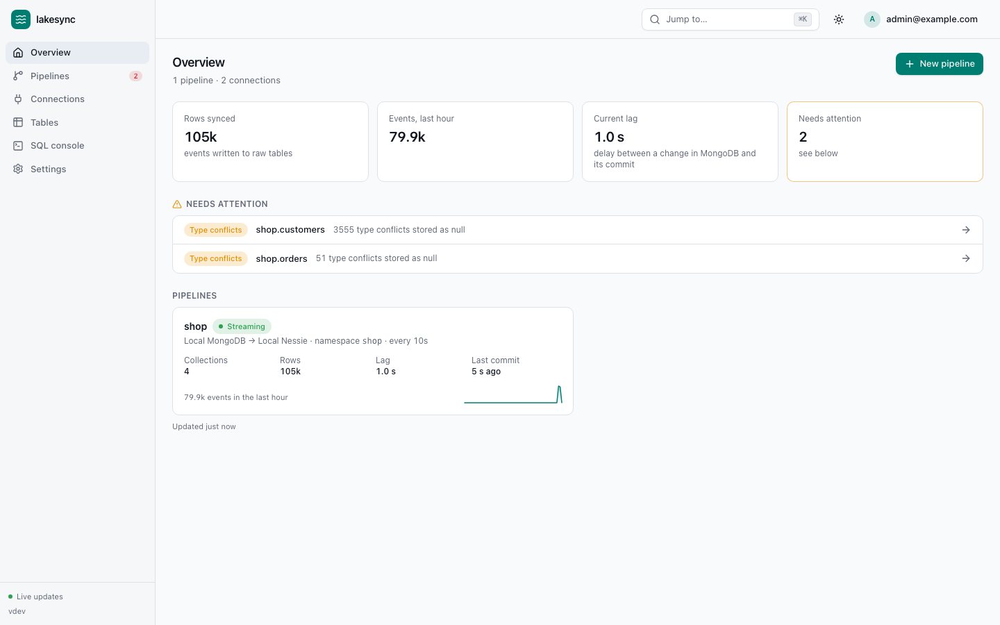
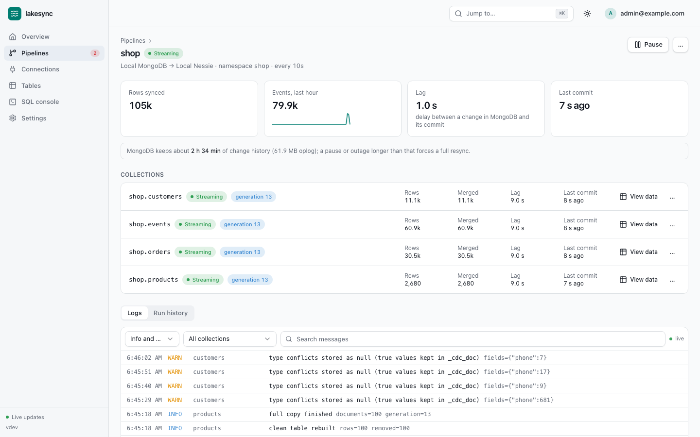
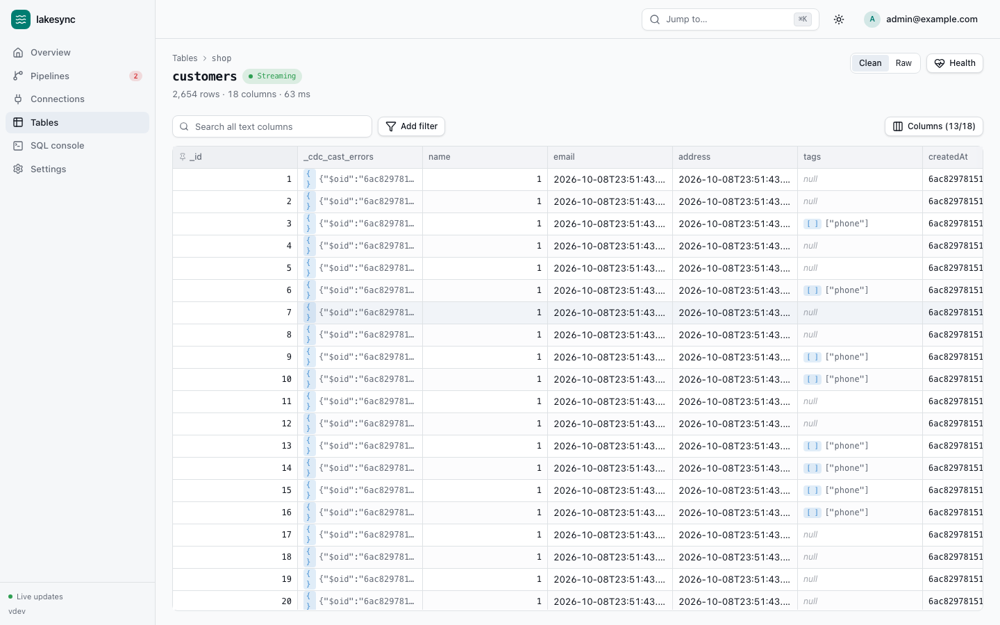
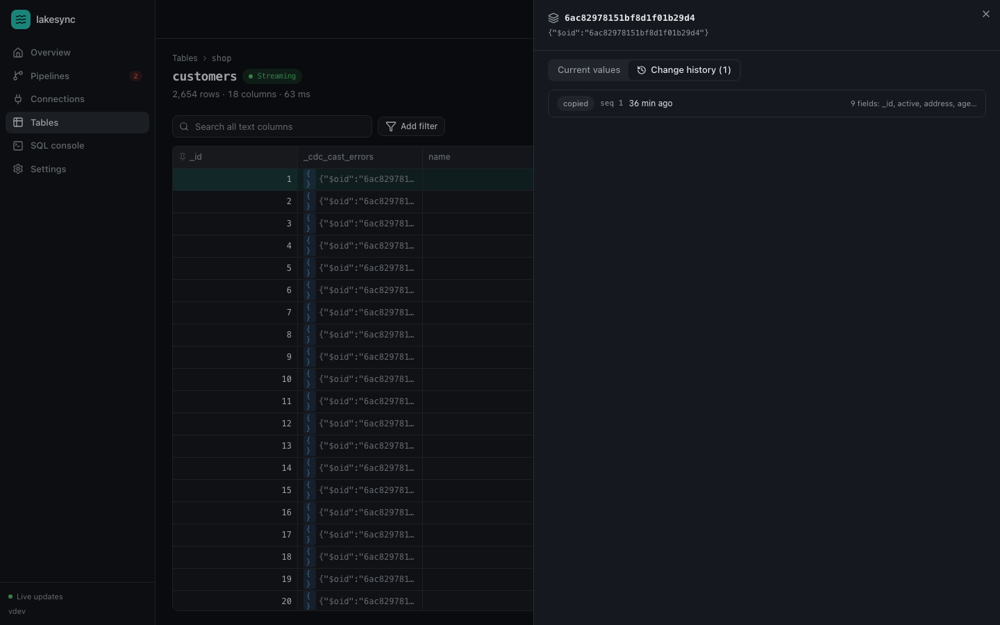
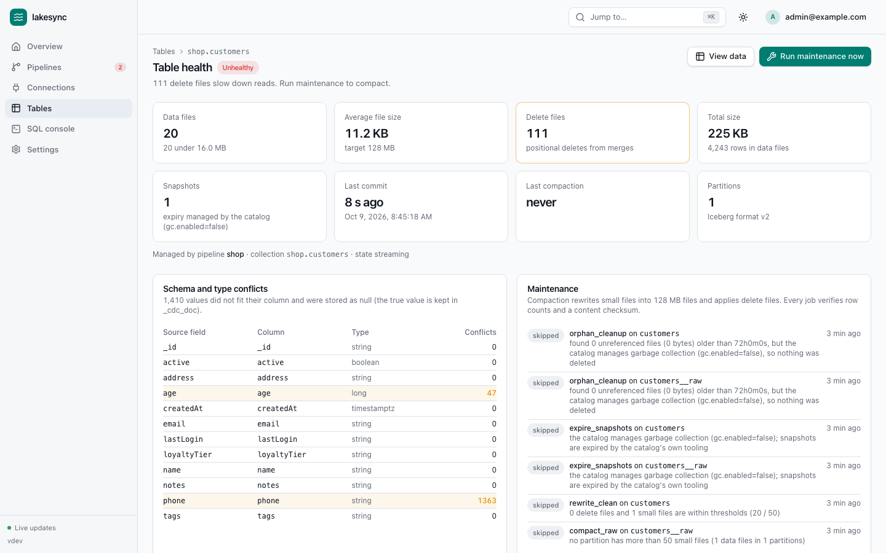
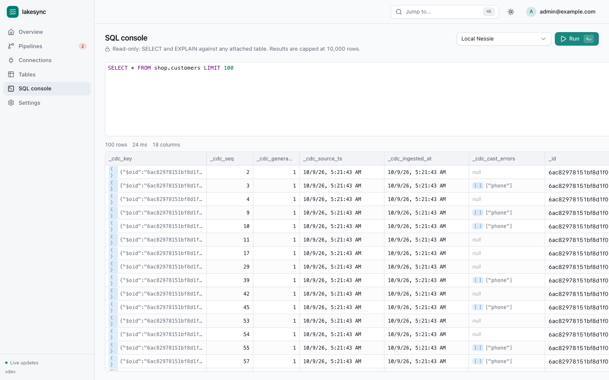
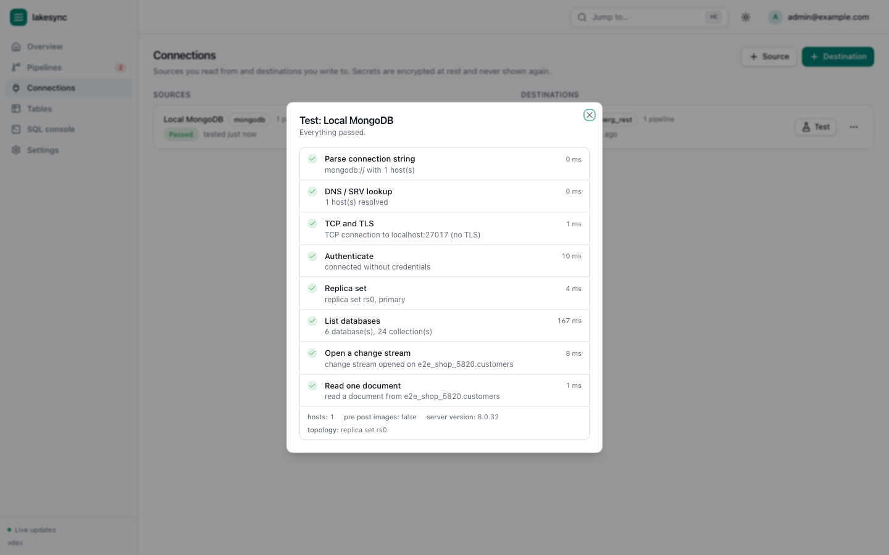

# lakesync

**MongoDB → Apache Iceberg, with the data viewer built in.**

lakesync is a self-hostable web app that copies MongoDB collections into Apache Iceberg tables,
keeps them in sync through change streams (inserts, updates, replaces and deletes, about once a
minute), and lets you look at the result without Spark, Trino or Athena: browse and filter rows,
read every document's change history, run read-only SQL, and watch each table's health.



- **Works from any browser.** One Go binary serves the UI, the API and the sync worker.
- **Built-in viewer.** A virtualised grid over tens of millions of rows, server-side paging,
  sorting, per-column filters, full-text search, JSON side panel, document change history with
  field-level diffs, and a SQL console with autocomplete, all on DuckDB.
- **Correct by construction.** Every batch is one Iceberg commit that carries its own checkpoint;
  crashes and restarts lose nothing and duplicate nothing. `lakesync verify` proves it.
- **Cloud neutral.** Only the Iceberg REST catalog spec and the S3 API. Nessie + RustFS locally;
  Lakekeeper, Polaris, Cloudflare R2 Data Catalog, AWS Glue/S3 Tables, or any S3-compatible store
  in production, by configuration only.
- **Pluggable sources.** MongoDB first; a second source implements one interface and registers a
  JSON schema for its form, nothing else changes.

## Quickstart (local, five commands)

Needs Docker (with Compose) and `make`.

```bash
git clone <this repository> lakesync && cd lakesync   # 1
make up                                                # 2  builds the image, starts MongoDB, RustFS, Nessie, Postgres and lakesync
make seed                                              # 3  loads the "shop" database and generates changes for 5 minutes
open http://localhost:8080                             # 4  log in: admin@example.com / changeme-now
# 5  click "Start setup", press "Use the local stack values" in both connection forms, pick the shop collections, Create and start
```

`make seed` runs against the local MongoDB (`localhost:27017`); it introduces a brand-new field
after one minute and type conflicts after two, so you can watch schema evolution and the
Table health screen react. `make verify` compares every collection with its clean Iceberg table.

Other targets: `make dev` (Go live reload + Vite dev server), `make test`, `make e2e`,
`make lint`, `make docker` (multi-arch image), `make down`, `make reset` (also deletes volumes).

## Screens

| | |
|---|---|
|  Pipeline detail: state per collection, progress, lag, live logs, run history |  Data viewer: paging, sorting, filters, search, JSON side panel |
|  Document detail with change history and diffs |  Table health: files, deletes, snapshots, conflicts, maintenance |
|  Read-only SQL console with autocomplete and history |  Connection tests as a checklist with plain-English hints |

Light and dark variants of every screen are in [`docs/screenshots`](docs/screenshots).

## How it works

Each collection gets two Iceberg tables: `<collection>__raw` (every change event, append only)
and `<collection>` (the latest version of each document). The worker takes a change-stream
bookmark, copies the existing documents in `_id` ranges, then replays the stream from the
bookmark. Every flush is one commit whose snapshot summary and table properties carry the
checkpoint. DuckDB merges new raw rows into the clean table every sync interval with an
idempotent `DELETE` + `INSERT` transaction. Maintenance compacts small files, applies delete
files, and expires snapshots where the catalog allows it.

Read [`docs/ARCHITECTURE.md`](docs/ARCHITECTURE.md) for the design, [`docs/phase0.md`](docs/phase0.md)
for what was proven before building, [`DECISIONS.md`](DECISIONS.md) for every decision and
[`KNOWN_LIMITATIONS.md`](KNOWN_LIMITATIONS.md) for what does not work yet.

## Deploying

- Single VM with automatic HTTPS: [`docs/deploy-vm.md`](docs/deploy-vm.md) (`deploy/vm`: lakesync + Postgres + Caddy).
- Destinations: [`docs/destinations.md`](docs/destinations.md) (Nessie + RustFS tested; R2, Glue/S3 Tables, Polaris, Lakekeeper documented).
- MongoDB Atlas: [`docs/mongodb-atlas.md`](docs/mongodb-atlas.md).
- Configuration reference: [`.env.example`](.env.example).

## Commands

```
lakesync serve               API + UI + worker (default)
lakesync serve --no-worker   API + UI only
lakesync worker              worker only (any number of them; advisory locks keep collections exclusive)
lakesync migrate             apply database migrations (serve does this on start)
lakesync seed                generate test data (see seed -h)
lakesync verify              compare MongoDB collections with their clean tables
lakesync gen-key             print a fresh APP_SECRET_KEY
```

Health: `GET /healthz`, `GET /readyz`. Metrics: `GET /metrics` (Prometheus). API reference:
`GET /api/openapi.json`.

## Status

See [`docs/FINAL_REPORT.md`](docs/FINAL_REPORT.md) for the acceptance checklist with evidence and
[`docs/BENCHMARKS.md`](docs/BENCHMARKS.md) for measurements. No licence file yet; the owner decides.
